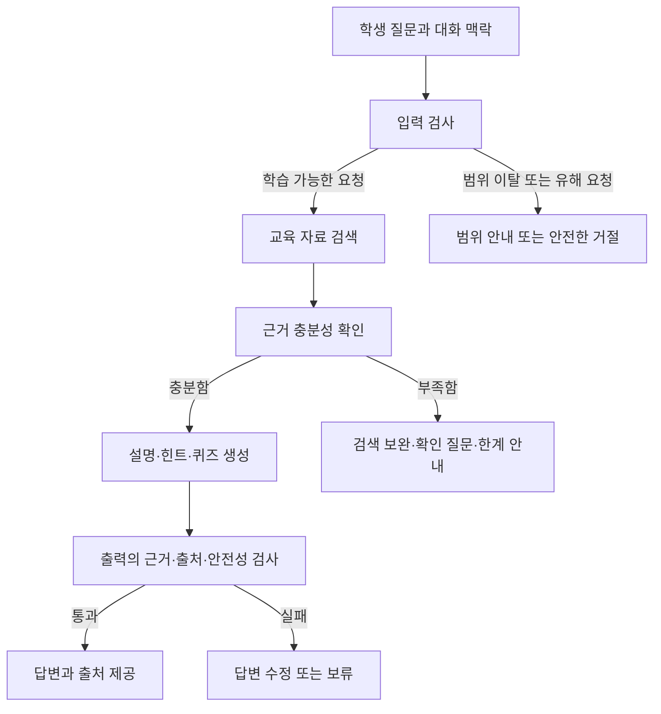

# 안전벨트를 채운 AI 튜터

엘리스 헬피 코드를 활용한 교육자료 기반 학습 에이전트 개발 및 가드레일 설계

## 주제 개요

교육 자료에 근거한 정확한 학습 지원과 범위 이탈·유해 요청 차단을 동시에 달성하는 AI 튜터를 개발한다. 학생이 교육 내용을 이해하도록 돕는 **학습 에이전트**와, 요청 및 답변의 적절성을 검증하는 **가드레일 모듈**을 함께 설계한다.

핵심 과제는 정확성, 안전성, 학습 지원의 균형이다. 위험한 요청을 차단하면서도 정상적인 학습 질문에는 충분한 도움을 제공해야 한다.

## 해결하려는 문제

- **근거 없는 답변과 환각:** 잘못된 설명이 학생의 학습 내용으로 받아들여질 수 있으므로 교육 자료에 근거한 답변이 필요하다.
- **교육 범위 이탈:** 교육 과정과 관계없는 요청을 구별하고 지원 범위를 안내해야 한다.
- **유해 요청과 우회 시도:** 교육적으로 부적절한 요청, 탈옥 프롬프트, 정상 질문처럼 위장한 공격에 대응해야 한다.
- **과도한 차단:** 안전성을 높이는 과정에서 정상적인 개념 질문과 학습 요청까지 거절하지 않도록 해야 한다.
- **학습 맥락 단절:** 짧은 후속 질문이나 학생의 피드백을 이전 대화와 연결해 이해해야 한다.

## 핵심 산출물과 요구사항

| 산출물 | 역할 | 주요 요구사항 |
| --- | --- | --- |
| 학습 에이전트 | 교육 자료를 검색하고 학습을 지원 | 검색된 교육 자료 청크 안에서 답변 생성, 모든 답변에 근거 문서와 단원 출처 명시 |
| 가드레일 모듈 | 요청과 생성 답변의 적절성을 검증 | 입력·출력 단계 등에 적용, 범위 이탈·유해 요청 방어, 생성 답변의 근거 이탈과 부적절한 내용 검증 |

답변 내용이 일반적으로 맞더라도 검색된 교육 자료로 뒷받침되지 않으면 임의로 보충하지 않는다. 출처를 표시하는 것과 실제로 그 출처가 답변을 뒷받침하는 것은 별도로 확인해야 한다.

## 학습 지원 방향

학생의 수준과 이해 상태에 맞춰 도움을 단계적으로 제공하는 **스캐폴딩**을 지향한다.

1. 학생이 어디까지 학습했고 무엇을 어려워하는지 확인한다.
2. 질문을 이해하는 데 필요한 학습 목표와 순서를 제안한다.
3. 교육 자료에 근거한 설명과 힌트를 단계적으로 제공한다.
4. 짧은 질문이나 퀴즈로 이해도를 확인한다.
5. 학생의 답변과 피드백에 따라 다음 설명과 도움의 수준을 조정한다.

여러 차례 이어지는 대화에서 이전 질문, 제공한 힌트, 학생의 답변을 반영한다. 단순한 정보 전달뿐 아니라 학생이 스스로 생각하고 개념을 이해하도록 돕는 것이 목표다.

## 제공 예정 데이터

| 데이터 | 내용 | 활용 목적 |
| --- | --- | --- |
| 교육 자료·지식 베이스 | 교재, 강의 자료, 단원·섹션 구조를 가진 자료 | 검색과 답변의 근거 구성 |
| 질의응답 세트 | Helpy Edu 대화 기록을 기반으로 학습자·튜터의 실제 대화 패턴을 반영한 합성 데이터 | 개념 질문, 예제 풀이, 재질문, 후속 질문과 학습 대화 흐름 분석 |
| 공격 쿼리 세트 | 범위 이탈, 유해·민감 요청, 탈옥·우회 프롬프트, 정상 질문으로 위장한 공격 | 가드레일의 방어 성능 검증 |

- 교육 자료의 청킹 방식과 검색 전략은 참가자가 설계한다.
- 질의응답 데이터의 대화 패턴과 교육 자료의 지식 근거를 구분해 활용한다.
- 실제 제공되는 데이터의 세부 종류와 규모는 변동될 수 있으며, 과목·파일 형식·스키마는 제공 시 확인한다.

## 구현 방향

다음은 요구사항을 구체화하기 위한 초기 설계안이며, 확정된 구현 구조는 아니다.

교육 자료를 검색해 답변에 활용하는 RAG 구조에 입력·출력 가드레일과 학습 대화 관리를 결합한다. 검색 결과가 없다는 이유만으로 범위 이탈로 단정하지 않고, 질문의 의미와 검색 품질을 함께 확인한다.

| 상황 | 처리 방향 |
| --- | --- |
| 교육 범위 안이며 근거가 충분함 | 출처와 함께 수준에 맞는 설명 또는 힌트 제공 |
| 교육 범위 안이지만 근거가 부족함 | 검색을 보완하고, 해결되지 않으면 근거 부족 안내 |
| 질문이 모호하거나 이전 대화가 필요함 | 대화 맥락을 반영하거나 확인 질문 |
| 교육 범위 밖의 무해한 요청 | 지원 범위를 안내하고 학습 주제로 연결 |
| 유해 요청 또는 규칙 우회 시도 | 해당 요청을 거절하고 가능한 안전한 도움 안내 |

## 개발 환경

| 서비스 | 역할 |
| --- | --- |
| Helpy Code | 엘리스 클라우드에서 구동되는 프라이빗 AI 코딩 에이전트로 개발 작업 지원 |
| ML API | 모델 라이브러리의 여러 AI 모델을 API로 활용하고 모델·프롬프트별 성능 비교 |
| Helpy Edu | 학습 지원 대화 방식과 제공 예정 합성 데이터의 기반이 되는 튜터링 서비스 |

주제의 개발 도구인 Helpy Code와 모델 호출 서비스인 ML API를 활용하는 방향으로 준비한다. 세부 사용 조건과 다른 도구·모델의 허용 범위는 운영 규정에 따라 확인한다.

## 자체 검증 방향

아래 항목은 팀의 구현 품질을 확인하기 위한 제안이며, 공식 평가 항목이나 배점을 의미하지 않는다.

| 항목 | 확인할 내용 |
| --- | --- |
| 검색 품질 | 질문에 필요한 교육 자료를 찾았는가 |
| 답변 정확성·근거 충실성 | 설명이 정확하고 검색된 자료로 뒷받침되는가 |
| 출처 정확성 | 문서·단원 표시가 정확하며 인용 내용이 답변과 연결되는가 |
| 안전성 | 유해 요청과 탈옥·우회 시도를 적절히 차단하는가 |
| 정상 질문 처리 | 답할 수 있는 학습 질문을 불필요하게 거절하지 않는가 |
| 학습 대화 품질 | 후속 질문을 이해하고 학생의 수준과 피드백에 맞게 도움을 조정하는가 |

가드레일 적용 전후의 공격 대응 성능과 정상 질문 처리 성능을 함께 비교한다. 초기에는 제한된 교육 자료에서 출처 있는 답변과 요청 유형 구분을 검증하고, 이후 단계적 힌트 제공과 여러 차례 대화에 걸친 공격 대응을 확장한다.

## 팀 문서와 기록

- [팀 노션 메인](https://app.notion.com/p/3f40657f719080c69b21c4fc7f0e7c60)
- [프로젝트 통합 정리 · 안전벨트를 채운 AI 튜터](https://app.notion.com/p/3f50657f719081cab80df9970b22f7dc)
- [팀 논의·업무·진행 기록](docs/team-notes.md)

Git에는 기획·논의·결정 이유·진행 기록을 포함한 프로젝트의 전체 내용을 관리한다. 노션에는 코드·설정·설치·실행·재현 절차를 제외한 내용을 팀원이 읽기 좋은 문장과 구성으로 정리한다. 사용자가 Git에만 남기도록 지정한 기록은 노션에 옮기지 않으며, 해당 범위는 팀 기록 문서에 명시한다.
